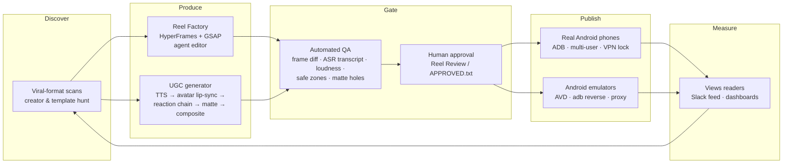

# Flowcut Studio

**An AI-native short-form video studio, packaged as code: editing, UGC video generation and automated publishing to real phones and Android emulators.**

Flowcut is the production system behind [flowcut.cc](https://flowcut.cc) and the [@shreyansharora05](https://instagram.com/shreyansharora05) Instagram channel. It also runs the UGC growth programme for Masonry (masonry.so). It does three jobs:

| Engine | What it does | Where |
|---|---|---|
| **1. Editing: Reel Factory** | Turns a reference reel and a talking-head take into a finished, platform-safe reel, with an agent-driven pipeline and hard quality gates | [`editing/`](editing) · [docs/editing.md](docs/editing.md) |
| **2. UGC automation** | Generates localized AI-presenter videos: script → voice → lip-synced avatar → reaction picture-in-picture → composite → QA | [`ugc/`](ugc) · [docs/ugc-automation.md](docs/ugc-automation.md) |
| **3. Publishing** | Warms up and posts to Instagram and TikTok from a fleet of **real Android phones** and **Android emulators**, each locked to its own country | [`posting/`](posting) · [docs/phone-publishing.md](docs/phone-publishing.md) · [docs/emulator-publishing.md](docs/emulator-publishing.md) |

It was built as an internal tool. The plan is to turn it into a product.

---

## Results so far

| | |
|---|---|
| **112** HyperFrames reel projects and **105** written reel breakdowns | Reel Factory, Jul–Nov 2026 |
| **32** published client films | Demi, Rocket.ai, Moonshot, Farfield, Nometria, Nadernejad Media, @thepmfguy, 100xEngineers and others |
| **401K plays** across 35 reels on @shreyansharora05, two of them breakouts at **143K** and **128K** | Channel audit, Aug 2026 |
| **13.8M** creator views tracked across TikTok, Instagram, YouTube and Facebook, plus **5.2M** on the brand's own channels | Masonry UGC programme, Aug–Nov 2026 |
| **4.77M** views in a single month (Nov 2026), about **207K/day** | Same programme |
| **6+ languages** of AI-presenter videos (JA, ES, PT, DE, FR, EN) | UGC automation |
| **−69%** generation cost per video (239 → 74 credits) | Per-persona "studio" reuse |
| **14,122-line** learnings log and **492** memory files | The editor's accumulated judgement, versioned with the code |

Details and the client roster are in [docs/results.md](docs/results.md).

---

## How it fits together



Every arrow is a file on disk: rendered MP4s, `captions.json`, queue files and append-only JSONL logs. Any stage can be re-run on its own, audited or replayed.

---

## Repository map

```
flowcut-studio/
├── editing/                 Engine 1: Reel Factory
│   ├── CLAUDE.md            the agent editor's boot brain (9-stage pipeline, gates, design language)
│   ├── SAFE-ZONES.md        researched Instagram/TikTok UI safe zones (hard gate)
│   ├── gkit/                template engine: palettes, pacing, SFX, plates, chunked render, QA
│   ├── example-project/     a complete reel project (build scripts, gates, index.html composition)
│   ├── review/  + rr        Reel Review: a local frame.io (frame-pinned notes, markup, version stacking)
│   ├── share/               Cloudflare Worker that serves Reel Review to clients on a private link
│   └── ig-autodm/           comment-keyword → auto-DM through the Instagram Graph API
├── ugc/                     Engine 2: AI-presenter UGC generation
│   ├── pipeline/            make.py (build stages), gen.sh (paid generation), alphafix.py (matte repair + QA)
│   ├── fleet/               shared helpers: TTS, Whisper alignment, captions, per-account renders, QA
│   └── qa/review_hwy.sh     side-by-side review against the approved master
├── posting/                 Engine 3: publishing
│   ├── instagram/           warm-up, Edits-app posting, scheduler, pre-flight, readiness gate, engagement, views
│   ├── tiktok/              controller loop, warm-up engine, posting
│   ├── lava/                a second phone's isolated posting stack (own VPN per account)
│   ├── emulator/            AVD launchers + local forwarding proxy for emulator egress
│   └── phone_feed.py        every post / warm-up / failure → Slack, plus a daily summary
├── config/                  example configs (accounts, queue item, approval allowlist, off-target filter)
└── docs/                    the write-ups below
```

## Docs

- [Editing pipeline (Reel Factory)](docs/editing.md)
- [UGC automation (AI-presenter videos)](docs/ugc-automation.md)
- [Publishing from real phones](docs/phone-publishing.md)
- [Publishing from Android emulators](docs/emulator-publishing.md)
- [Reliability engineering: pre-flight, self-tests, gates](docs/reliability.md)
- [Results and clients](docs/results.md)
- [Editing learnings (excerpt)](docs/editing-learnings.md)

## Tech stack

**Languages:** Python (about 30K lines across the system), JavaScript (HyperFrames compositions, Reel Review, Cloudflare Worker), Bash.
**Video:** FFmpeg filtergraphs, HyperFrames + GSAP (HTML → video), OpenCV + NumPy (alpha-matte repair), Whisper on PyTorch (ASR, word timing, script verification), Playwright (real-UI capture).
**Generative:** ElevenLabs (TTS), HeyGen Avatar (photo → lip-synced talking head), PixVerse and other image-to-video models, Sync Lipsync, run through the Masonry CLI. A local vision model (Ollama) classifies reels during warm-up.
**Devices:** Android (ADB, uiautomator view-tree dumps, multi-user profiles, always-on VPN lockdown), Android Emulator (AVD), PhoneDock.
**Infra:** macOS LaunchAgents, Linux VPS cron, GitHub Actions, Cloudflare Workers + KV, Slack incoming webhooks, Git.

## Setup (short version)

```bash
brew install ffmpeg android-platform-tools && pip install openai-whisper opencv-python numpy
npm i -g hyperframes          # or use npx hyperframes
cp config/jp_accounts.example.json posting/instagram/jp_accounts.json   # then edit
# secrets live outside the repo:
#   ~/.flowcut/slack_webhook   ~/.flowcut/proxies   ~/.elevenlabs/key   editing/share/config.json
```

Device serials in the code are placeholders (`REDMI_SERIAL`, `REALME_SERIAL`, `LAVA_SERIAL`). Replace them with your own `adb devices` IDs. Each doc has the detailed setup for its engine.

## What is not in this repo

No credentials, proxy accounts, account handles, client footage, creator personal data or internal business figures. Rendered media, A-roll masters and SFX packs are excluded by design. Everything here is code, configuration templates and documentation.

---

© 2026 Shreyansh Arora / Flowcut. All rights reserved. The source is public for reference; contact for licensing.
