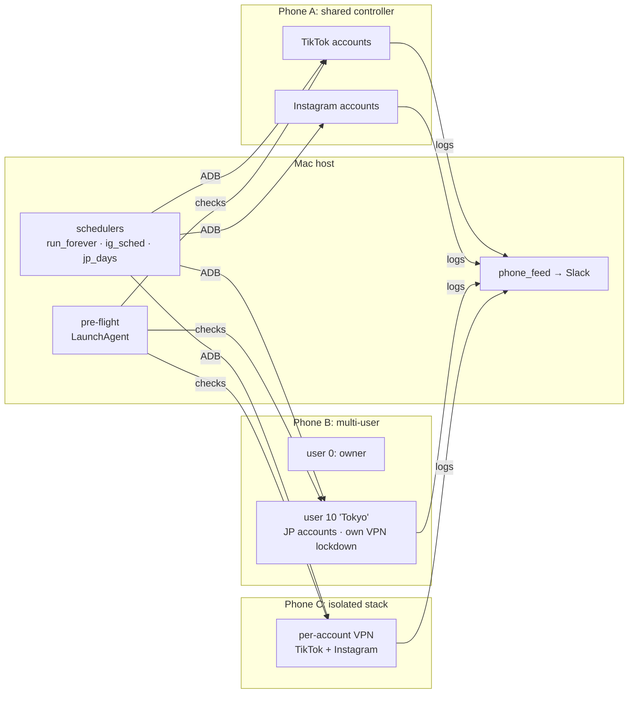

# Engine 3a: Publishing from real Android phones

Flowcut posts to Instagram and TikTok from **real Android phones on USB**, driven over **ADB** from one Mac. Each account belongs to one market (US, Mexico, Brazil, Japan, Germany …). Its traffic leaves the phone **in that market's country**, it posts in that market's prime time, and it only posts after a human-like warm-up session.

## 1. Driving the phone: a view-tree state machine
- Every action reads the screen as a **uiautomator view-tree dump** (`ui()`) and matches it with regexes on text, content-description and resource ID, then taps the matched node's centre. Nothing relies on fixed coordinates, so the automation survives layout changes and different screen sizes. Each device has a scale table (720×1640, 1080×2412 …).
- When an app renames every resource ID in an update (TikTok 47.7 did), the matchers fall back to visible text.
- Labels are matched in every UI language the fleet uses: `Switch accounts|アカウントを切り替える`, `Continue with Instagram|Instagramでログイン` …
- Waits are conditions (`wait(pattern, secs)`), not sleeps. Human pacing comes from randomised `sleep(a, b)` ranges.

## 2. One country per account
- **[`posting/instagram/vpn.py`](../posting/instagram/vpn.py)** switches the phone's VPN to the account's country, then **verifies the public IP's country from the phone itself** (ipinfo.io from the device shell, which goes through the VPN). If the check fails, the session is skipped instead of running in the wrong country.
- **Android multi-user profiles** isolate whole account groups on one phone. Japanese accounts live in Android **user 10**, which has its own app installs and its **own always-on VPN with lockdown** (`always_on_vpn_app` + `always_on_vpn_lockdown`), so no packet leaves outside Japan. The owner keeps using user 0.
- A third phone ([`posting/lava/`](../posting/lava)) has a fully separate stack (`lava_vpn.py`, `lava_post.py`, `lava_warm.py`), so its accounts never share code paths or VPN state with the others.

## 3. Warm-up sessions: account health before any post
**[`ig_warm.py`](../posting/instagram/ig_warm.py)** (about 12 min per session):
1. Switch to the account.
2. Open 2 niche hashtags in the account's language through deep links, and watch 4–8 reels from each.
3. Scroll Reels.

- **On-topic reels:** watched, liked about 25%, saved about 8%. Follows are capped at 2 per session and 5 per day, from day 2.
- **Off-topic or off-target-market reels:** skipped fast and marked *Not interested*, so the feed converges on the niche.
- **Never engaged:** the brand's paid creators, its own channels or any fleet account.

**[`jp_warm.py`](../posting/instagram/jp_warm.py)** (30–40 min, a fuller human model for new accounts):
- The session moves through home feed (~2 min) → 2 native-language searches (~8 min) → 3 tracked niche-creator profiles (~10 min) → Reels.
- **Relevant reels** are watched 10–25 s, sometimes 45 s. **Off-topic** ones are skipped after 1.5–4 s.
- Likes, saves and follows are spread at random to hit a per-day target that ramps from day 1 to day 3.
- Noise: random 20–60 s pauses, scrolling back up, reading comments, peeking at a creator's profile.
- A **local vision model** (Ollama, JSON-schema output) classifies each reel's screenshot as *target-language? on-niche? off-target?* in about 3–6 s, on-device on the Mac.
- **Hard stop** on any challenge, limit or verify screen, or if the VPN lock is off. The screen is saved to `out/jp_stops/` and Slack is alerted.
- A session that saw **fewer than 5 reels exits with code 4**. It doesn't count as a warm-up, so it can't unlock a post.

## 4. Posting: through the Edits app
**[`ig_post_edits.py`](../posting/instagram/ig_post_edits.py) / [`jp_post_edits.py`](../posting/instagram/jp_post_edits.py)**:
1. Push the MP4 into `DCIM/Camera` with a fresh timestamp.
2. Switch Instagram to the account and **read the handle back** from the screen.
3. Open Instagram's **Edits** app, log it in through "Continue with Instagram" (no passwords stored), and switch to the same account.
4. Pick the newest gallery video and **check its duration matches the file**.
5. Add audio if the template needs it (an original sound at about 25%, saved to the account beforehand).
6. Type the caption, then **read it back exactly** via the clipboard. Captions use the account's language plus `[bracketed keywords]`, with no #/@ spam.
7. Turn on the **AI label**, then share.
8. **A post only counts when the profile's post count goes up.** Anything else is logged as `NOT LIVE` and alerted.

TikTok has its own poster ([`posting/tiktok/post.py`](../posting/tiktok/post.py)). It picks hashtags **from TikTok's suggestion dropdown** rather than typing them raw.

## 5. Scheduling rules (encoded, not remembered)
[`run_forever.py`](../posting/tiktok/run_forever.py) is the single controller for the shared phone. It holds a `flock` (one instance only) and is restarted by a watchdog. It posts when an account is due, warms up in between, and pulls stats every 3 h. Rules, from [`plan.py`](../posting/tiktok/plan.py), [`ig_sched.py`](../posting/instagram/ig_sched.py) and `run_forever.py`:

| Rule | Value |
|---|---|
| Same account, between posts | ≥ 1 h |
| Any two posts on one phone | ≥ 45 min |
| Warm-up required before a post | within the last 2 h |
| Copies of one template on different accounts | ≥ 3 h (IG) / 8 h (TikTok) apart |
| Posting windows | audience prime time **on the audience's clock**: 07–09, 12–14, 18–23 |
| Max per account per audience-day | 3 |
| Human approval | only names in `APPROVED.txt` ever post |
| Kill switches | `STOP_*` / `PAUSE` / `HOLD_post_<key>` files, honoured at every step |

The rules live in JSON (`posting_plan.json`), so they can change without a code change. `jp_days.py` runs each market's daily cycle (warm-up → readiness gate → post), with ±15 min jitter. Accounts on the same phone run in random order with 8–15 min gaps, and different phones run in parallel threads.

## 6. Early engagement
[`jp_fast_engage.py`](../posting/instagram/jp_fast_engage.py) watches the post log. Within **5–10 minutes** of a new post, a sibling account on another phone switches its VPN to the poster's market, then watches the full video, likes, saves and comments about 1 in 3 times. It pauses that phone's controller for the duration without interrupting a post in progress.

## 7. Observability
- **[`phone_feed.py`](../posting/phone_feed.py)** reads every loop's own log (it never touches the phones) and sends one Slack line per event through an incoming webhook:
  - post live / failed / not live;
  - warm-up finished;
  - a challenge, CAPTCHA, logout, VPN down, crash, phone off USB or loop gone.
  
  There's also a **daily summary**. Messages queue in `outbox.jsonl` while the webhook is missing.
- **Views without paid APIs:** [`jp_views.py`](../posting/instagram/jp_views.py) reads each account's public reels page logged out, matches each reel to the post log within 3 h, and appends every reading to a JSONL history, so you get per-video view curves at zero cost.

## Setup
1. Enable USB debugging and authorise the Mac (`adb devices`).
2. Replace `REDMI_SERIAL`, `REALME_SERIAL` and `LAVA_SERIAL` with your devices' serials.
3. Install Instagram, Edits and TikTok (and a VPN app) in every Android user that posts.
4. Copy `config/jp_accounts.example.json` → `posting/instagram/jp_accounts.json` and set handle, phone, user, sibling and proxy per account.
5. Put the Slack webhook in `~/.flowcut/slack_webhook`.
6. Run: `caffeinate -i python3 posting/tiktok/run_forever.py`, `python3 posting/instagram/jp_days.py`, `python3 posting/phone_feed.py`.

Keep the host awake. A sleeping laptop drops USB phones mid-session (lid-closed sleep was a real outage).
