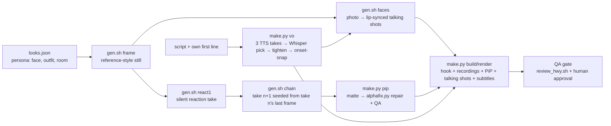

# Engine 2: UGC automation (AI-presenter videos)

This engine produces **localized AI-presenter explainer videos** at fleet scale. One approved master ("v1c") is re-made per persona: her own face, voice, room and outfit, and her own first line. Everything that makes the master work stays identical: the hook, the screen recordings, the cuts, the title and the call to action.

Output: 1080×1920, 30 fps, H.264, about 10 Mbps, about 100 s.

## Stages

### 1. Persona look (`gen.sh <key> frame`, about 2 credits)
A reference-matched still per persona, built from `looks.json` (face, hair, top, room). It reproduces the reference's camera language: a **propped camera, never a selfie arm**, head and shoulders, a plain room and a fixed prop. Created once per persona and reused (see *studio reuse*).

### 2. Voice (`make.py <key> vo`)
- Each persona has her own ElevenLabs voice. **Three takes** of the script are generated.
- Each take is transcribed with **Whisper medium** (PyTorch), and a token-level match against the script picks the best one. This catches mispronunciations automatically. In one run, all three takes of a line said 「ストライ」 instead of 「ストーリー」, so only that line was regenerated at speed 1.0, re-verified, spliced in at the shot cut and loudness-matched.
- Silence is tightened, and each cut is **onset-snapped** so scene changes land on word boundaries. `script_units` / `align_units` map Whisper words back onto the script text, so subtitles always show the script's words, not the ASR's.

### 3. Talking shots (`gen.sh <key> faces`, about 72 credits)
- A photo-to-avatar lip-sync model (HeyGen Avatar 6 Turbo) is driven by each speech slice.
- The base still has a **neutral, closed mouth**. When a base clip that already "chatted" was used, lip-sync drifted.

### 4. Reaction chain (`gen.sh <key> react1`, then `chain`, about 165 credits)
- The silent, skeptical reaction under the hook is one **continuous forward performance** made of 4 image-to-video takes (15 + 15 + 15 + 10 s). **Take n+1 is seeded from take n's last frame**, so there is no visible loop. An earlier version ping-ponged a short clip, and the owner rejected it.
- Takes are trimmed at drift points (an unwanted smile, a dropped prop) before chaining.

### 5. Picture-in-picture matte and repair ([`alphafix.py`](../ugc/pipeline/alphafix.py))
Background removal gives the cut-out. Mattes fail on thin props and open mouths, so every frame is repaired:
1. **RGB is rebuilt from the source**, because the matte zeroes RGB where alpha is 0 and a filled hole would otherwise show black.
2. **Enclosed transparent regions are filled**: anything not connected to the frame border becomes opaque.
3. A 7 px elliptical close, kept as max.
4. **Temporal repair**: a frame whose opaque area inside the subject box drops more than 3% below the median of its ±3 neighbours takes the maximum of its neighbours' alpha.
5. **QA**: the build **fails** (exit 2) if any frame still has an enclosed hole or an area drop. Stats are logged per video: 1,321 frames, 0 flags on the first repaired master.

### 6. Build and render (`make.py <key> build|render|final`)
Programmatic **FFmpeg filtergraphs**:
- scaling, cropping and colour normalisation of the SDR screen recordings (used unmodified, with no mock layers);
- the PiP overlay;
- a big top hook title;
- per-scene subtitle bands that stay off the recordings' own text and never spill a sentence onto the next scene;
- the call-to-action end card.

### 7. Variation for multi-account posting
Each account's copy has its own voice, first line, face, room, outfit and caption, so the posts are distinct rather than copies.

## QA before anything posts

[`ugc/qa/review_hwy.sh`](../ugc/qa/review_hwy.sh) `<video> <outdir>` produces:
- side-by-side sheets of the candidate and the approved master every 2 s (structure, title, subtitle placement and recording order at a glance);
- a reaction-crop sheet at 1 fps, plus 5–6 fps crops at every take join and prop close-up (where matte holes hide);
- a second-half talking-shot strip (lip movement, hands, prop, identity);
- a loudness reading and a Whisper transcript to diff against the script.

Then a human approves. The posting scheduler only publishes names on the `APPROVED.txt` allowlist.

## Cost engineering

| Item | Credits |
|---|---|
| Persona still | ~2 |
| Lip-synced talking shots (3) | ~72 |
| Reaction chain (4 takes) | ~165 |
| **First video per persona** | **~239** |
| **Later videos (studio reused)** | **~74 (−69%)** |

- **Studio reuse**: room, outfit and reaction set are made once per persona, and only the talking shots are new for later videos.
- Paid steps **stop on the first failed submit** (exit 3) and never top up, which gives a hard daily budget.
- Job IDs are cached, so a restart never pays twice. Every stage skips if its output exists, so builders are safely re-runnable.
- Real run: 7 videos, 1,702 credits against a 1,670 estimate. The 2% overrun came from 3 reaction takes cut short for smiling, each still charged in full.

## Files

| File | Role |
|---|---|
| `ugc/pipeline/gen.sh` | Paid generation: `frame`, `faces`, `react1`, `chain` |
| `ugc/pipeline/make.py` | Free stages: `vo`, `slices`, `pip`, `build`, `render`, `final` |
| `ugc/pipeline/alphafix.py` | Matte repair and the alpha QA gate (OpenCV + NumPy) |
| `ugc/fleet/ig_common.py` | TTS, Whisper language check, script alignment, segment starts, luma QA |
| `ugc/fleet/common.py` | Per-account render helpers, generation job cache, variation (trim, punch-in, grade) |
| `ugc/fleet/hwy.py` | The earlier fleet builder (12 accounts per run) |
| `ugc/fleet/captions.py` | A different caption per account, in its language, with bracketed keywords |
| `ugc/fleet/ig_qa.py` | Black-frame, flash and duration QA on delivered files |
